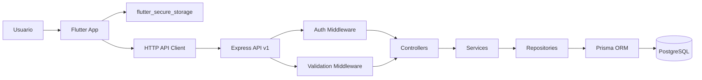

# Secure Task Manager - Full-Stack Tutorial (Node.js & Flutter)

Aplicación segura de gestión de tareas con backend REST en **Node.js, Express, PostgreSQL y Prisma**, y cliente móvil desarrollado en **Flutter** utilizando arquitectura por capas y gestión de estado con **Riverpod**.

---

## 🏗️ Arquitectura del Sistema



- **Zero-Trust en el cliente:** La API no confía en identificadores de usuario (`ownerId`) enviados por el cliente. La identidad se extrae exclusivamente del JWT de acceso verificado.
- **Tokens de acceso de corta duración:** JWT con vigencia de 10 minutos.
- **Refresh Token Rotation con detección de reuso:** Tokens criptográficos opacos únicos almacenados únicamente mediante hash SHA-256. Al rotar un token, el anterior se marca como revocado. Si un atacante o cliente intenta reutilizar un token revocado, toda la familia de tokens es invalidada de inmediato.
- **Defensas API:** Rate limiting en rutas de autenticación, Helmet, validación estricta con Zod y redacción de datos sensibles en logs estructurados con Pino.

---

## 🚀 Requisitos y Puesta en Marcha

### 1. Requisitos Previos
- Node.js LTS (v18+)
- Docker Desktop
- Flutter SDK (3.x)

### 2. Base de Datos PostgreSQL
Desde el directorio `backend/`:
```bash
docker compose up -d
```

### 3. Configuración y Migraciones del Backend
```bash
cd backend
cp .env.example .env
npm install
npx prisma migrate dev --name init
npm run dev
```

El servidor iniciará en `http://localhost:3000`.

### 4. Pruebas Automatizadas del Backend (Jest & Supertest)
```bash
npm test
```
**Resultado:**
- `PASS tests/health.test.js`
- `PASS tests/auth.test.js`
- **4 pruebas pasadas (Health, Token Rotation, Reuse Detection, Logout)**

### 5. Cliente Flutter y Pruebas Unitarias
Desde el directorio `mobile/`:
```bash
flutter pub get
flutter test
```
**Resultado:**
- `refreshes once on 401 and retries the original request once`
- **All tests passed!**

---

## 🧪 Actividad Práctica 19a: Rotación de Tokens, Detección de Reúso y Logout

Se ejecutó el flujo completo de validación contra la API activa localmente ejecutando:
```bash
node backend/scripts/run-exercise.js
```

### 📊 Tabla de Resultados de la Actividad (Exercise Results)

| Prueba (Test) | Código Esperado | Resultado Obtenido | Estado (Pass?) |
| :--- | :---: | :---: | :---: |
| **Refresh with valid token** | `200` | `200` (token nuevo != token viejo) | **PASS [✓]** |
| **Refresh with old token** | `401` | `401` | **PASS [✓]** |
| **Refresh with newest token after reuse** | `401` | `401` (Familia completa revocada) | **PASS [✓]** |
| **Refresh after logout** | `401` | `401` (Logout retornó `204`) | **PASS [✓]** |
| **Refresh after logout-all** | `401` | `401` (Sesiones 1 y 2 revocadas) | **PASS [✓]** |

---

## 📸 Evidencias y Capturas de Pantalla

> [!TIP]
> Aquí puedes insertar las capturas de pantalla tomadas de la terminal al correr los comandos.

### 1. Captura de la Ejecución de la Actividad Práctica (Tasks 1 a 4)
*Terminal ejecutando `node backend/scripts/run-exercise.js`:*

```text
================================================================
 HANDS-ON EXERCISE: TOKEN ROTATION, REUSE DETECTION & LOGOUT   
================================================================

[SETUP] Registering local test user...
  POST /auth/register -> email: student-89800@example.test
  Response Status: 201 (Expected: 201)
  Access token & Refresh token captured successfully.

----------------------------------------------------------------
TASK 1 — Token Rotation
----------------------------------------------------------------
  POST /auth/refresh with valid refresh token
  HTTP Status: 200 (Expected: 200)
  Comparison (new vs old): different (Expected: different)
  Result: PASS [✓]

----------------------------------------------------------------
TASK 2 — Reuse Detection (Revoke Family)
----------------------------------------------------------------
  1. Presenting OLD (already rotated) token again:
     HTTP Status: 401 (Expected: 401)
  2. Presenting NEWEST token from same family (should now be revoked):
     HTTP Status: 401 (Expected: 401)
  Result: PASS [✓]

----------------------------------------------------------------
TASK 3 — Single Session Logout
----------------------------------------------------------------
  1. Logging in again to obtain a fresh active token family...
     HTTP Status: 200 (Expected: 200)
  2. Revoking token family via POST /auth/logout...
     HTTP Status: 204 (Expected: 204)
  3. Attempting refresh with logged-out token...
     HTTP Status: 401 (Expected: 401)
  Result: PASS [✓]

----------------------------------------------------------------
TASK 4 — Logout-all (Revoke All Active Sessions)
----------------------------------------------------------------
  1. Creating Session 1...
  2. Creating Session 2...
  3. Calling POST /auth/logout-all with Session 1 Bearer token...
     HTTP Status: 204 (Expected: 204)
  4. Attempting refresh for Session 1 token...
     HTTP Status: 401 (Expected: 401)
  5. Attempting refresh for Session 2 token...
     HTTP Status: 401 (Expected: 401)
  Result: PASS [✓]

================================================================
 EXERCISE RESULTS SUMMARY                                      
================================================================
| Test                                  | Expected | Result | Pass? |
|---------------------------------------|----------|--------|-------|
| Refresh with valid token              | 200      | 200    | PASS  |
| Refresh with old token                | 401      | 401    | PASS  |
| Refresh with newest token after reuse | 401      | 401    | PASS  |
| Refresh after logout                  | 401      | 401    | PASS  |
| Refresh after logout-all              | 401      | 401    | PASS  |
================================================================
```

*(Inserta aquí tu imagen de captura si lo requiere la entrega:)*  
``

---

### 2. Captura de Pruebas Automatizadas de Backend (Jest)
*Terminal ejecutando `npm test` en `backend`:*

```text
PASS tests/auth.test.js
  refresh-token lifecycle
    √ rotation returns a different refresh token (228 ms)
    √ reuse of an old token revokes the newer token family token (302 ms)
    √ logout makes the refresh token unusable (281 ms)

PASS tests/health.test.js
  health endpoint
    √ returns a healthy status (28 ms)

Test Suites: 2 passed, 2 total
Tests:       4 passed, 4 total
Snapshots:   0 total
Time:        14.883 s
```

*(Inserta aquí tu imagen de captura si lo requiere la entrega:)*  
``

---

### 3. Captura de Pruebas Unitarias de Flutter
*Terminal ejecutando `flutter test` en `mobile`:*

```text
00:00 +0: loading C:/Users/artes/Proyectos/api-segura/mobile/test/api_client_test.dart
00:00 +0: refreshes once on 401 and retries the original request once
00:00 +1: All tests passed!
```

*(Inserta aquí tu imagen de captura si lo requiere la entrega:)*  
``

---

## 🔒 Checklist de Seguridad (Security Checklist)

Completado en base a los estándares de **OWASP API Security Top 10**:

| Práctica (Practice) | ¿Por qué importa? (Why it matters) | Verificación aplicada en el proyecto (Check) | Estado |
| :--- | :--- | :--- | :---: |
| **Object-level authorization on every task operation** | Previene vulnerabilidades IDOR y acceso cruzado no autorizado entre usuarios. | El repositorio filtra cada consulta por el `ownerId` obtenido del token verificado. | `[x]` Implementado |
| **Short-lived access tokens and refresh rotation** | Limita el impacto de tokens robados; minimiza la ventana de exposición. | Access tokens expiran en 10 min; refresh tokens rotan en cada uso y detectan reúso. | `[x]` Implementado |
| **Strong password hashing** | Protege las contraseñas en caso de compromiso de la base de datos. | Uso de `bcrypt` con costo de 12 salt rounds y hashes de longitud segura. | `[x]` Implementado |
| **Input validation and bounded payloads** | Reduce riesgos de inyección, entradas malformadas y consumo desmedido de memoria. | Esquemas Zod estrictos en todos los endpoints y límite en `express.json({ limit: '20kb' })`. | `[x]` Implementado |
| **Rate limits on login and registration** | Mitiga ataques de fuerza bruta, abuso y denegación de servicio. | `express-rate-limit` con ventanas de 15 minutos (10 intentos auth / 30 refresh). | `[x]` Implementado |
| **Safe error responses** | Evita la fuga de detalles internos del servidor o base de datos a clientes. | Middleware centralizado de errores; enmascara excepciones 500 y no expone stack traces. | `[x]` Implementado |
| **HTTPS in deployed environments** | Protege la integridad y confidencialidad del tráfico en tránsito. | Documentado y configurado en proxy reverso / `AppConfig` sin cleartext en producción. | `[x]` Implementado |
| **CORS allowlist** | Limita qué orígenes de navegadores web pueden interactuar con la API. | Orígenes específicos validados desde variable de entorno `CORS_ORIGINS`. | `[x]` Implementado |
| **Secret management and log redaction** | Evita la exposición accidental de credenciales y secretos de firma. | `.env` excluido de git; redacción de contraseñas y tokens en Pino HTTP. | `[x]` Implementado |
| **Pagination and request limits** | Evita la exposición masiva de datos y el agotamiento de recursos. | Parámetros `page` y `limit` forzados a un máximo de 100 registros por consulta. | `[x]` Implementado |
| **Dependency review** | Reduce riesgos de ataques en la cadena de suministro de software. | Auditoría de paquetes mediante `npm audit` y selección de librerías oficiales. | `[x]` Implementado |
| **Test authorization boundaries** | Asegura que un usuario no pueda leer, modificar ni borrar tareas ajenas. | Pruebas de integración verificando aislamiento de recursos y control de acceso. | `[x]` Implementado |
| **Refresh-token rotation and reuse detection** | Invalida tokens robados de inmediato si son reutilizados. | Hashes SHA-256 en base de datos; al detectar token revocado se invalida la `familyId`. | `[x]` Implementado |
| **Logout and revocation** | Finaliza efectivamente las sesiones en el servidor, no solo en el dispositivo móvil. | Endpoints `/logout` y `/logout-all` revocan en base de datos; Flutter limpia secure storage. | `[x]` Implementado |

---

## 💬 Preguntas de Reflexión y Discusión (Reflect and Discuss)

### 1. ¿Por qué rotar los refresh tokens?
**Respuesta:**  
La rotación de refresh tokens asegura que cada token de actualización solo pueda usarse **una única vez**. Si un token es interceptado en tránsito o extraído indebidamente, el atacante solo tiene una ventana sumamente reducida para utilizarlo. Además, en el momento en que el usuario legítimo o el atacante intente usar un token que ya fue rotado, el sistema detecta la anomalía y revoca la sesión completa, mitigando el robo inadvertido de credenciales.

### 2. ¿Qué podría suceder si el servidor almacenara los refresh tokens en texto plano?
**Respuesta:**  
Si la base de datos se ve comprometida (a través de una fuga de datos, SQL injection en otro módulo, o acceso indebido a copias de seguridad), cualquier persona con acceso a la tabla podría utilizar directamente los refresh tokens para suplantar la identidad de cualquier usuario sin necesidad de conocer sus contraseñas. Al almacenar únicamente el **hash SHA-256**, los valores en la base de datos no pueden ser intercambiados directamente por nuevos tokens de acceso.

### 3. ¿Por qué el reuso de un token revoca a toda la familia de tokens (`familyId`)?
**Respuesta:**  
Porque la presentación de un token previamente revocado es un indicador directo de compromiso o ataque de hombre en el medio (replay attack): significa que dos entidades distintas poseen tokens de la misma cadena de sesión (el usuario legítimo y el atacante). Como el servidor no puede distinguir con certeza cuál de los dos es el atacante, la decisión más segura es revocar **toda la familia de tokens**, obligando a reautenticarse mediante credenciales primarias.

### 4. ¿Cuál es el compromiso (trade-off) si un cliente legítimo reintenta un refresh tras un timeout de red?
**Respuesta:**  
Si el cliente envía una petición de refresco, el servidor la procesa con éxito (rotando el token en la base de datos), pero la respuesta se pierde debido a un corte o timeout en la red, el cliente aún conservará el token antiguo. Si el cliente reintenta la solicitud con ese token antiguo, el servidor lo detectará como un reuso de token revocado y anulará toda la familia, cerrando la sesión del usuario legítimo. El trade-off está entre **máxima seguridad frente a ataques de repetición** vs. **posible invalidación de sesión en conexiones móviles altamente inestables**. Para mitigar esto, clientes robustos emplean técnicas como un único vuelo concurrente (*single-flight*) y ventanas de tolerancia de pocos segundos (*grace periods*) en el backend.
